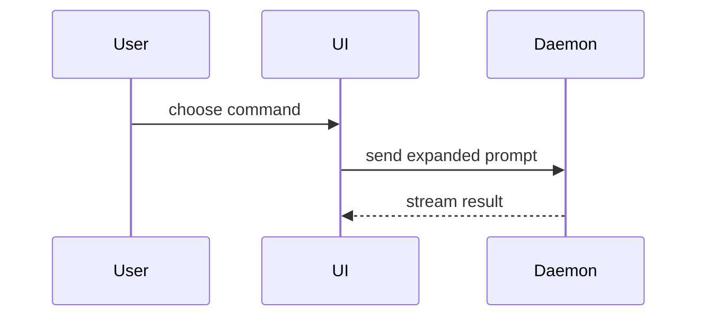

# Show Me

Help the user understand the current topic visually. Skip the preamble, keep prose brief, and pick the smallest view that makes the key point clear.

## Choose a View

Use one or several views only when each adds useful information. Place each visual next to the short text it supports. Keep only the calls, files, props, states, and boundaries needed to answer the current question or compare the options under discussion.

### Logic or Algorithm

Show logic as pseudocode:

```text
on(save)
  if content is unchanged
    return cached result
  write new content
  return fresh result
```

### Runtime Control Flow

Show runtime control flow as a call tree:

```text
submitForm
  createSession
    persistPrompt
    launchAgent
  navigateToSession
```

### UI Structure

Show UI structure as a component tree, including state and module boundaries that matter:

```tsx
<SessionPage> (apps/example/src/routes/session.tsx)
  useSessionEvents()
  <SessionToolbar>
    <RunSkillButton> (packages/ui)
```

### File Responsibilities

Show file responsibility or a broad refactor as a shallow file tree:

```text
src/
├── commands/       # parses user actions
├── sessions/       # owns session state
└── transport/      # sends API requests
```

### Interactions and Data Flow

Show component interaction, control flow, or data flow with Mermaid:



## Show Changes

Use `diff` when the point is what changes and the surrounding shape already exists. Match the diff shape to the topic.

### Component Change

```diff
 <SessionPage>
   useSessionEvents()
   <SessionToolbar>
+    <RunSkillButton />
   <SessionTimeline>
+    <SkillResultCard />
```

### File-Layout Change

```diff
 src/
 ├── commands/
+│   └── show-me.ts       # expands the slash command
 ├── sessions/
-└── transport.ts
+└── transport/
+    ├── client.ts
+    └── stream.ts
```

### Call-Tree or Call-Stack Change

```diff
 submitForm
   createSession
     persistPrompt
+    expandSkillMention
     launchAgent
-  navigateToSession
+  navigateToSession
+    subscribeToEvents
```

### State or Control-Flow Change

```diff
 on(save)
-  write content
+  if content is unchanged
+    return cached result
+  write content
+  invalidate cache
```

## Show a Complete Block

Show the whole block when most of it is new, when omitted context would hide ownership or order, or when the user needs a copyable target shape:

```ts
function expandSkill(command: string): string {
  const skillName = command.slice(1)
  return `use the ${skillName} skill`
}
```

## Create an HTML Artifact

For a visual UI, layout, state comparison, or concept too dense for Mermaid, write one focused HTML file: a diagram, an infographic, or a short slide deck, whichever fits the point.

- Match the product's colors, type, spacing, and components.
- Use real labels and data.
- Support desktop and mobile.
- Name the file `show-me-{description}.html`.
- Open it with `xdg-open "path/to/show-me-{description}.html"` on Linux or `open "path/to/show-me-{description}.html"` on macOS when a graphical browser is available.
- If opening is unavailable or fails, provide the file path instead; do not claim it opened.
